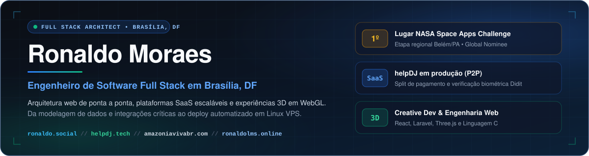

  

    

  
  
  
  

    

  
  

---

### Engenharia de Ponta a Ponta

Sou **Ronaldo Moraes**, Engenheiro de Software Full Stack baseado em **Brasília, DF** e graduando em Ciência da Computação (CEUB). Projeto e entrego sistemas completos da concepção arquitetural à operação em produção — da modelagem relacional, regras financeiras e APIs REST seguras à construção de interfaces reativas, cenas **3D WebGL** a 60 FPS e provisionamento em **Linux VPS** com containers Docker, proxy reverso e SSL.

---

### Projetos em Destaque

<table>
  <tr>
    <td width="33.3%" valign="top">
      <h3>🌿 Amazônia Viva</h3>
      

        <strong>1º Lugar Regional NASA Space Apps Challenge (Belém/PA) • Global Nominee</strong>
      

      

        Plataforma de inteligência ambiental voltada à proteção territorial da Amazônia. Harmoniza séries históricas e alertas recentes de focos de calor entre os sensores orbitais <strong>MODIS e VIIRS (NASA FIRMS)</strong> cruzados com territórios indígenas.
      

      

        <a href="https://amazoniavivabr.com"><strong>amazoniavivabr.com →</strong></a>
      

    </td>
    <td width="33.3%" valign="top">
      <h3>🎧 helpDJ Marketplace</h3>
      

        <strong>SaaS P2P em Produção • PHP Laravel &amp; React</strong>
      

      

        Marketplace para locação de equipamentos profissionais de DJs com reserva em tempo real, contratos digitais, <strong>split de pagamento</strong> automatizado e <strong>verificação biométrica Didit</strong> (KYC) entre locadores e contratantes.
      

      

        <a href="https://helpdj.tech"><strong>helpdj.tech →</strong></a>
      

    </td>
    <td width="33.3%" valign="top">
      <h3>🏙️ Cidade Interativa 3D</h3>
      

        <strong>Portfólio Web Dirigível • Three.js &amp; Vite</strong>
      

      

        Experiência web em tempo real onde visitantes dirigem um veículo por distritos temáticos dos projetos, com minimapa radar, rotatórias, física de colisão, Web Audio Lo-Fi/Synthwave e alternância direta para Showcase Web.
      

      

        <a href="https://ronaldo.social"><strong>ronaldo.social →</strong></a>
      

    </td>
  </tr>
</table>

---

### Engenharia de Software &amp; Sistemas Acadêmicos

- **♻️ Ciranda:** Plataforma de brechó circular estruturada com o padrão arquitetural **_Facade_**, encapsulando fluxos de catalogação sustentável e cálculo automatizado de economia de **água e CO₂e** gerada pela reutilização de peças.
- **🃏 Texas Hold'em em C (`Chipzen.ai`):** Motor de simulação e regras de pôquer desenvolvido em **Linguagem C**, com embaralhamento **_Fisher-Yates_**, máquina de estados das rodadas de apostas e avaliador de mãos de baixa latência.
- **🐉 Dangerous Dragon:** Jogo arcade implementado do zero em **Linguagem C pura**, com gerenciamento manual de memória via `structs` e ponteiros, detecção de colisão por hitbox e game loop determinístico.

---

### Stack Principal

  
  
  
  
  
  
  
  

